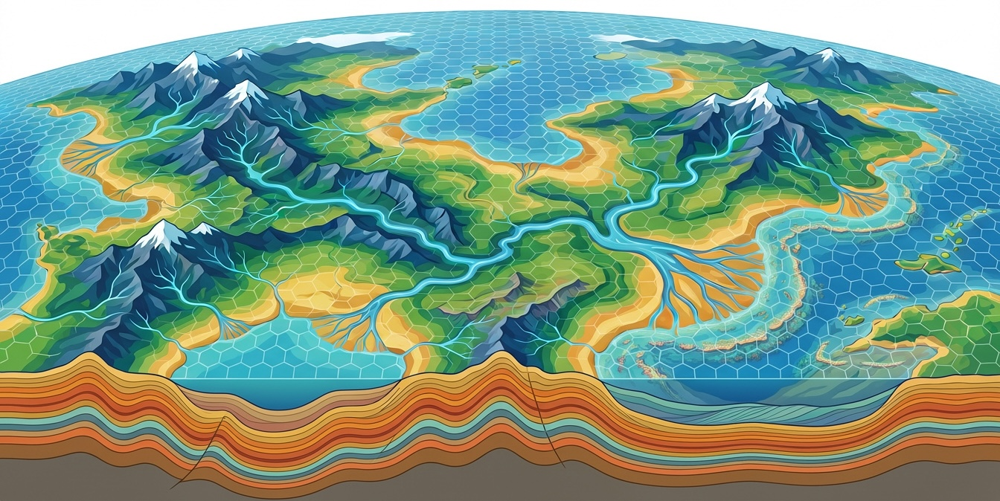

## gospl / Global Scalable Paleo Landscape Evolution  /

**gospl** is an open source, GPL-licensed library providing a scalable parallelised Python-based numerical model to simulate the evolution of landscapes and sedimentary basins from catchment to global scale.

## Statement of need

> Since the 1990s, landscape evolution models have been used to estimate long-term catchment dynamics, drainage evolution and the formation of sedimentary basins in response to tectonic and climatic forcing. They rely on a set of mathematical and physical laws for sediment erosion, transport and deposition, and reproduce the first-order complexity of the Earth's surface.

> goSPL extends this approach from catchment to **global scale** and over geological time, on meshes of tens of millions of nodes. Beyond river incision, hillslope and marine sediment transport, it couples near-surface hydrology (water table and duricrust), weathering geochemistry, soil production, glacial erosion, flexural isostasy, orographic rainfall and stratigraphy, as well as marine gravity currents, carbonate platforms and karst, each optional and solved in parallel. It can be used to study how the Earth's surface interacts with the atmosphere, the hydrosphere and tectonic and mantle dynamics: the role of atmospheric circulation in denudation, the influence of sediment erosion and deposition on mantle convection, the location and abundance of natural resources, or the evolution of life.

## Documentation

1. an overview of the different ways to **install** the code,
2. some **technical** notes on the underlying physics and implementation,
3. a **user guide** with some notebook examples, and
4. the **API** references.

## Contributing to gospl

Contributions of any kind to **gospl** are more than welcome. That does not mean new code only, but also improvements of documentation and user guide, additional tests (ideally filling the gaps in existing suite) or bug reports or ideas on what could be added or done better.

All contributions should go through our GitHub repository. Bug reports, ideas or even questions should be raised by opening an issue on the GitHub tracker. Suggestions for changes in code or documentation should be submitted as a pull request. However, if you are not sure what to do, feel free to open an issue. All discussion will then take place on GitHub to keep the development of **gospl** transparent.

If you decide to contribute to the codebase, ensure that you are using an up-to-date master branch. The latest development version will always be there, including the documentation (powered by sphinx).

Full docs are available at: https://gospl.readthedocs.io/en/feat-gravity-carbonates-karst/ (the documentation of this branch).

## License

This program is free software: you can redistribute it and/or modify it under the terms of the GNU  General Public License as published by the Free Software Foundation, either version 3 of the License, or (at your option) any later version.

This program is distributed in the hope that it will be useful, but WITHOUT ANY WARRANTY; without even the implied warranty of MERCHANTABILITY or FITNESS FOR A PARTICULAR PURPOSE. See the GNU General Public License for more details.

You should have received a copy of the GNU General Public License along with this program. If not, see _http://www.gnu.org/licenses/gpl-3.0.en.html_.
