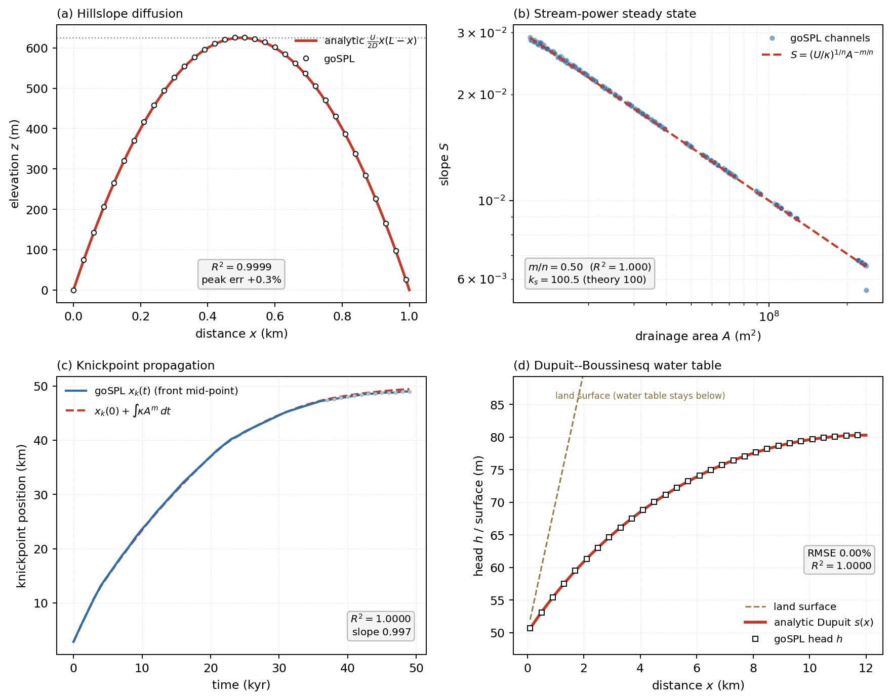
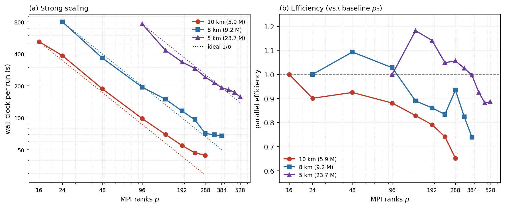

.. _benchmarks:

===============================
Tests and benchmarks
===============================

goSPL is checked in two ways: an automated **regression suite** that runs every
process end to end and guards its invariants (mass conservation, results
independent of the number of processors, restarts), and a set of **analytical
benchmarks** that compare the model with exact solutions. Both run in
continuous integration on Linux and macOS with Python 3.11 and 3.12, and a
release is published only when they pass.

.. contents:: On this page
   :local:
   :depth: 1

Analytical benchmarks
---------------------

   The four main benchmarks compared to exact solutions. (a) Steady
   hillslope-diffusion ridge grown by uniform uplift :math:`U` against linear
   diffusion :math:`D`: goSPL nodes (circles) lie on the parabola
   :math:`z(x) = (U/2D)\,x(L-x)` (peak error +0.3 %, :math:`R^2 = 0.9999`).
   (b) Detachment-limited stream-power steady state: the channel slope-area
   data (points) follow :math:`S = (U/\kappa)^{1/n} A^{-m/n}` (line),
   recovering :math:`m/n = 0.50` and a uniform steepness :math:`k_s = 100.5`
   (theory 100). (c) Knickpoint propagation after a 100 m base-level drop: the
   mid-point of the incision wave (blue) follows the celerity integral
   :math:`x_k(0) + \int \kappa A^m\,dt` (red dashed), fitted slope 0.997,
   :math:`R^2 > 0.9999`; grey points are near-headwater steps excluded from
   the fit. The first-order implicit scheme smears the front, so its leading
   and trailing edges (5 and 95 % of the drop) run about 12 % ahead of and
   behind the mid-point. (d) Steady Dupuit-Boussinesq water table for an
   unconfined aquifer with uniform recharge :math:`R`, conductivity
   :math:`K_h`, a fixed-head drain at :math:`x = 0` and a no-flow divide: the
   goSPL head (squares) matches :math:`s(x)^2 = s_d^2 + (R/K_h)(2Wx - x^2)`
   to :math:`R^2 = 1.000` and stays below the land surface (dashed).

   *Figure of the goSPL model-description paper (Geoscientific Model
   Development, in review).*

The benchmarks live in ``benchmarks/``, one file per process. Each builds its
own mesh and input, runs goSPL and measures the error against the exact
solution:

.. list-table::
   :header-rows: 1
   :widths: 22 40 38

   * - Process (file)
     - Exact solution
     - Result
   * - Linear hillslope diffusion (``test_hillslope.py``)
     - steady ridge :math:`z = (U/2D)\,x(L-x)`
     - :math:`R^2 = 0.9999`; peak within 0.3 %
   * - Non-linear hillslope (``test_hillslope_nonlinear.py``)
     - steady ridge of each law (Taylor series, critical slope, power law),
       :math:`D\,S\,F(S) = U x'` integrated from the divide
     - divide within 2.7, 2.7 and 1.3 % (linear law on the same mesh: 2.4 %)
   * - Stream power steady state (``test_spl.py``)
     - slope-area law :math:`S = (U/\kappa)^{1/n} A^{-m/n}`
     - :math:`m/n = 0.500`; slope-area :math:`R^2 = 0.9995`; steepness within
       0.5 %
   * - Knickpoint propagation (``test_knickpoint.py``)
     - celerity :math:`\kappa A^m`, front at
       :math:`x_k(0) + \int \kappa A^m\,dt`
     - fitted slope 0.997; :math:`R^2 > 0.9999`
   * - Dupuit water table (``test_dupuit.py``)
     - :math:`s^2 = s_d^2 + (R/K_h)(2Wx - x^2)`
     - RMSE 0.00 % of the head range; :math:`R^2 = 1.000`
   * - Flexure (``test_flexure.py``)
     - cosine loads :math:`w = q/(D k^4 + \Delta\rho g)`; infinite-plate line
       load; spherical-harmonic response :math:`q/(\Delta\rho g + D P_l)`
     - flat solver to round-off on the discrete operator, < 1 % against the
       continuum, second order; line load RMSE < 0.5 %; global 1e-9
   * - Orographic rain (``test_orography.py``)
     - Smith-Barstad transfer function over a ridge
     - RMSE < 1.5 % of the peak; first-order convergence
   * - Horizontal advection (``test_advection.py``)
     - translated Gaussian; uniform field
     - mass error < 1e-4 for each scheme; centroid, peak and shape; uniform
       field kept
   * - Marine diffusion (``test_marine_diffusion.py``)
     - two-dimensional heat kernel
     - volume to 1e-12; diffusivity, peak and RMSE within 2e-3 for both
       solvers
   * - Geochemistry (``test_geochem_balance.py``)
     - dissolved = precipitated + exported; 1-D strip
       :math:`c = D_0/(R+p)\,(L_s/u)^{1+p/R}`
     - budget closed to 1e-15 (also in parallel); strip within 2e-5

The geometry and parameters of the four benchmarks of the figure:

.. list-table::
   :header-rows: 1
   :widths: 16 26 34 24

   * - Benchmark
     - Domain and mesh
     - Forcing and parameters
     - Boundaries (N E S W), time
   * - Linear hillslope
     - 1 x 0.08 km strip; triangulated 10 m grid
     - :math:`U = 5 \times 10^{-4}` m/yr, :math:`D = 0.1` m²/yr
     - w f w f; :math:`\Delta t` = 10 kyr, 8 Myr
   * - Non-linear hillslope
     - 1 x 0.09 km strip; hexagonal lattice, 12.5 m
     - :math:`U = 5 \times 10^{-4}` m/yr, :math:`D = 0.5` m²/yr,
       :math:`S_c = 0.6`, :math:`N = 2`, :math:`p = 2`
     - w f w f; :math:`\Delta t` = 5 kyr, 3 Myr
   * - Stream power
     - 19.8 x 19.8 km; unstructured, 11,519 nodes (~200 m)
     - :math:`U = 4 \times 10^{-4}` m/yr, :math:`\kappa = 4 \times 10^{-6}`,
       :math:`m = 0.5`, :math:`n = 1`
     - f o o o; :math:`\Delta t` = 5 kyr, 5 Myr
   * - Knickpoint
     - 40 x 10 km; unstructured, 11,832 nodes (~200 m)
     - :math:`U` up to :math:`5 \times 10^{-3}` m/yr,
       :math:`\kappa = 2 \times 10^{-4}`, :math:`m = 0.5`; 100 m drop
     - o o o f; :math:`\Delta t` = 100 yr, 300 + 50 kyr
   * - Dupuit water table
     - 12 x 0.8 km strip; triangulated 100 m grid
     - :math:`K_h = 3650` m/yr, :math:`R = 0.1` m/yr, :math:`S_y = 0.1`,
       flat base
     - w w w f; relaxed to steady state

Boundaries: fixed base level (f), open outflow (o), no-flux wall (w). All runs
use single-flow routing and a rainfall of 1 m/yr where it matters, so that the
discharge :math:`Q` equals the drainage area :math:`A` numerically;
:math:`\kappa` is in :math:`\mathrm{m^{-1/2}\,yr^{-1/2}}`.

To run them (a few minutes each; they need ``scipy`` and ``matplotlib``):

.. code:: bash

    pytest benchmarks/ -m benchmark              # all of them
    pytest benchmarks/test_dupuit.py -m benchmark  # one

The figures they draw are written to ``results/<benchmark>/``.

Regression suite
----------------

The suite in ``tests/`` (about 330 tests) runs each process on small meshes
and checks what must hold whatever the parameters:

- **conservation**: sediment, each lithology, each provenance class and each
  solute species are conserved to round-off through erosion, transport,
  deposition and the stratigraphy;
- **partition invariance**: the same run on one and on several processors
  (two, and three and four for advection) gives the same mean elevation to
  a relative :math:`5 \times 10^{-9}`, the same sediment flux to
  :math:`10^{-5}`, the same maximum drainage area to :math:`10^{-4}` and the
  same summed drainage area to :math:`5 \times 10^{-2}` (the last limited by
  the floating-point floor of the iterative flow solve on near-flat regions);
- **parallel safety**: no deadlock when the processors take different
  paths, no whole-mesh array on every processor;
- **restart**: a run restarted from its outputs gives the same result as the
  continuous run;
- **options**: every input option is parsed and run at least once, and an
  option switched off leaves the results unchanged bit for bit.

The tests are grouped by process with ``pytest`` markers (``flow``,
``sediment``, ``strata``, ``groundwater``, ``mpi``, ...; the list is in
``tests/README.md``):

.. code:: bash

    pytest tests/ -n 4            # everything, on 4 cores (a few minutes)
    pytest tests/ -m flow         # one process
    pytest tests/ -m mpi          # the parallel tests

Every bug fixed in goSPL gets a test that fails without the fix; the list is
in ``docs/dev/FIXED_BUGS.md``.

Parallel scaling
----------------

   Strong scaling of goSPL on three global production meshes (NCI Gadi,
   48-core nodes), running the full surface-process model. (a) Wall-clock
   time per run against the number of MPI processes :math:`p`; dotted lines
   are the ideal :math:`1/p` scaling from each mesh's smallest run. (b)
   Parallel efficiency against :math:`p`, relative to the smallest feasible
   count for each mesh (16, 24 and 96 processes for the 10, 8 and 5 km
   meshes); the dashed line marks unit efficiency.

   *Figure of the goSPL model-description paper (Geoscientific Model
   Development, in review).*

Efficiency stays at or above about 0.85 up to roughly one hundred processes
and declines slowly beyond, as the partly serial global flexure and the
depression spill-over graph come to dominate. The 10 km mesh (5.9 million
nodes) reaches a speed-up of 11.7 at 288 processes, the 8 km mesh (9.2
million) 11.8 at 384, and the 5 km mesh (23.7 million) still gains at 528.
Details, per-phase timings and how to choose the number of processes:
:ref:`hpc_scaling`; the cost of each option in time and memory:
:ref:`option_cost`.
