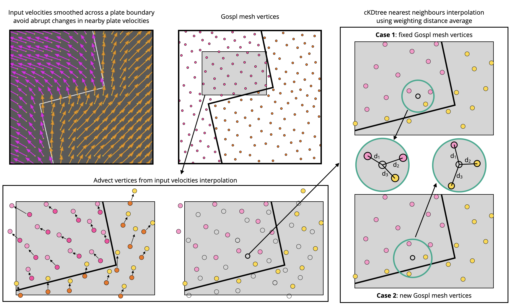
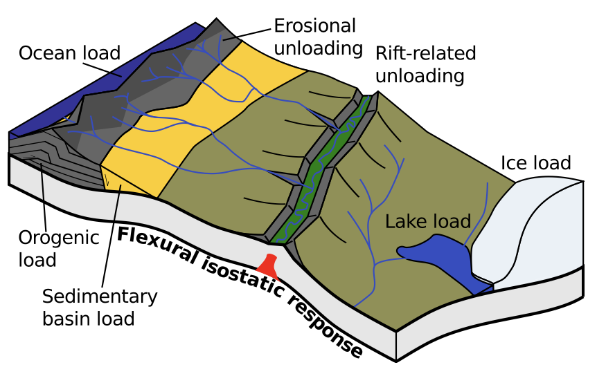

.. _tecto:

.. role:: yaml(code)
   :language: yaml

==================================
Tectonic forcing
==================================

.. contents:: On this page
   :local:
   :depth: 1

.. note::

  These forcing are user defined and could be either lithospheric or mantle induced but goSPL does not know which underlying process is inducing these changes and does not account for sediments and crust compression.

Uplift & subsidence
---------------------------------

In the most simple case of vertical-only displacements (*i.e.* uplift or subsidence), the model requires the declaration of successive events using :yaml:`start`, :yaml:`end` times and the tectonic rates map :yaml:`upsub` (in metres per year). This map is defined prior to the model run for goSPL spherical or 2D mesh as a  numpy zip array.

During the model run and for each time step, the prescribed rates are applied on all vertices of all partition by increasing or decreasing their elevation values following imposed local subsidence or uplift rates. The vertical displacement is applied at the start of each time step, before the surface processes, so an output is the state after a complete step (uplift and erosion both applied) and a steady-state landscape does not depend on the time step. (Until November 2026 it was applied at the end of the step, and every output carried one un-eroded increment :math:`\mathrm{U\,\Delta t}`.)

Horizontal advection
---------------------------------

The second, more complex, option consists in adding horizontal displacements (:yaml:`hdisp`). In this case, the user has to define for each point of the grid the associated velocities (represented by displacement fields in both X,Y and Z coordinates) and advection could be performed based on different techniques.

Whatever the technique, the horizontal motion carries:

- the surface fields: elevation, cumulative erosion/deposition, flexural response and soil thickness;
- when stratigraphy is recorded (``time: strat``), the **whole stratigraphic record**: layer thickness, elevation at deposition, porosity, per-layer erodibility multiplier (``stratK``) and, when the corresponding options are on, the dual-lithology fine pile, the in-model provenance classes and the duricrust records.

Using **Upwind** or **IIOE scheme**
^^^^^^^^^^^^^^^^^^^^^^^^^^^^^^^^^^^^^^

.. important::

  These schemes are designed for 2D meshes (flat or cyclic). Moving the stratigraphic record with them is also tested on a global (spherical) mesh, but the surface advection itself has not been validated on global simulations.

The Upwind scheme offers a rapid solution to the advection problem but with potentially excessive diffusion when solved implicitly (`first-order upwind implicitly scheme <https://www.sciencedirect.com/science/article/pii/S0168927414001032>`_).

Alternatively, the user can perform the advection of elevation and erosion by solving the advection equation based on a finite volume space discretization and a semi-implicit discretization in time called the Inflow-Implicit/Outflow-Explicit scheme and following the work from `Mikula & Ohlberger, 2014 <https://www.math.sk/mikula/mo-FVCA6.pdf>`_.

Setting the approach for a given simulation is done in the input file by setting the `advect` key to either `upwind`, `iioe1` or `iioe2`.

.. warning::

  These Eulerian schemes advect the elevation while the drainage is recomputed from it at every step, so **valleys are not carried across a horizontal motion perpendicular to the flow** (Hergarten and Fraters, 2026, `egusphere-2026-2060 <https://doi.org/10.5194/egusphere-2026-2060>`_). Use plate interpolation (``advect: 'interp'``) with ``domain: interp_remap: 1`` wherever the drainage is displaced laterally (see *Plate interpolation remaps* below).

  **Lateral-motion test.** A steady stream-power landscape (40 x 20 km, 200 m spacing, rivers draining south, uplift 1 mm/yr, ``K = 4e-5``, ``m = 0.5``, ``dt = 5`` kyr) was moved east at 4 mm/yr (0.1 cell per step) for 1 Myr while uplift and incision continued, and the valley pattern was located by cross-correlating the elevation across the flow with the initial one (``review_tests/adv_*.py`` of the GMD paper). Displacement of the valley pattern (imposed: 1, 2 and 4 km after 0.25, 0.5 and 1 Myr):

  .. list-table::
     :header-rows: 1
     :widths: 50 16 16 16

     * - method
       - 0.25 Myr
       - 0.5 Myr
       - 1 Myr
     * - ``upwind``, ``iioe1``, ``iioe2``
       - 0.6 to 0.9 km
       - lost
       - lost
     * - ``interp``, hand-split 50 kyr events (IDW)
       - 1.0 km
       - 2.0 km
       - 3.9 km
     * - ``interp`` remapped every step, 0.1 cell (IDW)
       - --
       - --
       - 0.7 km
     * - ``interp_remap: 0.1`` (barycentric)
       - --
       - 1.3 km
       - lost
     * - ``interp_remap: 0.5``, ``1``, ``2`` or ``5`` (barycentric)
       - --
       - 1.9 to 2.0 km
       - 4.0 km

  "Lost": the pattern no longer correlates with the initial one (the drainage reorganised). The size of the remap matters more than the scheme: a displacement of a tenth of a cell per remap either barely moves the valleys (inverse-distance weights mostly copy the nearest node) or, with barycentric weights, moves them at the right speed but smooths them away (linear interpolation diffuses a little at every remap). Remaps of half a cell to a few cells carry them.

.. note::

    In the IIOE approach, the outflow from a cell is treated explicitly while inflow is treated implicitly.

    Since the matrix of the system is determined by the inflow fluxes it is an M-matrix yielding favourable solvability and stability properties.

Both methods allow large time steps without losing stability and not deteriorating precision.

The IIOE is formally second order accurate in space and time for 1D advection problems with variable velocity and numerical experiments indicate its second order accuracy for smooth solutions in general.

.. note::

    Velocity at the face is taken to be the linear interpolation for each vertex (in a vertex-centered discretisation the dual of the delaunay triangulation (i.e. the voronoi mesh has its edges on the middle of the nodes edges)).

    Similarly we consider that the advected variable at the face is defined by linear interpolation from each connected vertex.

Two IIOE schemes are available: the first one (`iioe1`)
uses the technique defined `here <https://www.math.sk/mikula/mo-FVCA6.pdf>`_, the second (`iioe2`) is more computationally demanding but should limit instabilities in regions with large advection velocities (see `paper <https://www.sciencedirect.com/science/article/pii/S0168927414001032>`_).

**Stratigraphic record.** The layers cannot be advected one by one with these schemes (one linear solve per layer and per field at every step would be prohibitive). They are moved **semi-Lagrangian** at every time step, after the surface: each node takes the inverse-distance-weighted mix of the layers found at the three mesh nodes nearest to its departure point :math:`\mathbf{x} - \mathbf{v}\,\Delta t` (an exact copy when the departure point is a mesh node). The velocity field and :math:`\Delta t` are fixed within a tectonic interval, so the departure points and weights are computed once per interval and reused. On a regular grid moving one cell per time step, the record shifts by exactly one cell.

.. warning::

  The inverse-distance interpolation of the layers is not mass conservative on its own, and the surface is advected by the chosen scheme while the layers are interpolated: over long runs with strong horizontal motion, the summed layer thickness and the surface elevation can drift slightly apart. The cost of the layer move grows with the number of recorded layers (about 3% of the run time on a 1M-node mesh with a layer recorded every time step).

Using the **semi-lagrangian scheme**
^^^^^^^^^^^^^^^^^^^^^^^^^^^^^^^^^^^^^^

Used for global mesh, the horizontal advection (advect: `interp`) often corresponds to plate motions and can be obtained from plate-tectonic reconstruction software.

.. warning::

  Compared to vertical displacements applied at each time step, the horizontal advection for this method is only performed at the end of the specified tectonic interval (so usually of the order of several thousands to millions years).

  Illustration of interpolation between mesh vertices induced by horizontal velocities based on a semi-lagrangian scheme.

.. note::

  Due to tectonic advection, the density of the surface nodes evolves over time, which leads to areas showing rarefaction or accumulation of nodes. In order for the finite volume scheme to remain accurate, local addition and deletion of nodes and remeshing of the triangulated spherical surface are therefore required. However, the remeshing process is computationally expensive and requires to rebuild not only the delaunay mesh but also the associated voronoi one and to redistribute the mesh and its vertices parameters with `PETSc <https://www.mcs.anl.gov/petsc/>`_.

  To avoid remeshing, the initial mesh is assumed to remain fixed and the advected points are then used to interpolate the advected nodes informations (elevation, erosion, deposition, stratigraphic information...) onto the fixed ones using an inverse weighting distance approach on the **three** nearest advected points, found with a `SciPy cKDTree <https://docs.scipy.org/doc/scipy/reference/generated/scipy.spatial.cKDTree.html>`_. A mesh node that coincides with an advected point takes its values exactly. This is an efficient approach but it might not be the most accurate one. **Plate interpolation remaps** (``domain: interp_remap``, a number of mesh spacings, > 0). Without it, each tectonic event's displacement is applied once, at the event's end. With it, the event is applied in remaps: the interval is the whole number of time steps (at least one) over which the fastest node of the event moves about ``interp_remap`` mesh spacings (the spacing is the square root of the mean cell area); it is printed with ``-v``. If one remap would cover the whole event, the event is applied once at its end, as without the option. The interpolation tables are built once per event and reused at every remap (rebuilt only for a shorter last remap, or the first one after a restart).

With ``interp_remap`` the interpolation weights are always **barycentric** (there is no option to choose): each node takes the barycentric coordinates of the advected mesh triangle that contains it, and the three nearest points (inverse-distance weights) are used only where no advected triangle does, for instance on an inflow edge (on the 659k-node global example, 6 nodes). Linear interpolation reproduces a linear field exactly and is not biased towards the nearest point. This matters because the remap interval is set by the fastest nodes: where the velocity is lower, a remap moves the surface by a fraction of a cell. In a shear test (velocity growing linearly across the domain, one cell per remap for the fastest nodes), a bump moving a fifth of a cell per remap travelled 80.9 m of 80 m, against 70 m with inverse-distance weights. Plain ``interp`` (without ``interp_remap``) keeps the inverse-distance weights, so its results are unchanged.

**Parallel runs and memory.** The search tree is built on the whole advected mesh (a node's nearest advected points can come from anywhere), once per tectonic interval, and released straight away. Each process then keeps the interpolation weights of its own nodes only, and the values it needs (surface fields and stratigraphic layers) are fetched from the processes that own the source nodes. With ``interp_remap`` the candidate triangles are only those touching the advected points nearest to the process's own nodes, read from the cell list once per interval and released. No whole-mesh copy of any field is kept between plate updates, and the result does not depend on the number of processes.

Cyclic (periodic) 2D models
^^^^^^^^^^^^^^^^^^^^^^^^^^^^^

On a cyclic model the mesh is a cylinder, but the displacement rates are still given in the flat ``(vx, vy)`` frame (z component set to 0). goSPL maps them around the cylinder: the surface schemes use the cylinder-tangent velocity, and both the stratigraphy move and the ``interp`` plate interpolation displace the nodes exactly around the cylinder axis. Fields therefore wrap across the periodic seam. Cyclic models run in serial (one MPI process) only.

Flexural isostasy
---------------------------------

goSPL provides two flexural-isostasy solvers, selected by ``flexure: method``: a **parallel finite-volume biharmonic** solve performed directly on the unstructured mesh for 2D simulations (``'fem'``), and a **spherical-harmonic** solve for global (sphere) simulations (``'global'``). Neither uses a regular grid for the flexure itself — the 2D solve works node-by-node on the mesh, and the global solve works in the spherical-harmonic domain.

  Flexural isostasy can be produced in response to a range of geological loads (from `Wickert, 2016 <https://gmd.copernicus.org/articles/9/997/2016/gmd-9-997-2016.pdf>`_).

Flexural isostasy for 2D simulations
^^^^^^^^^^^^^^^^^^^^^^^^^^^^^^^^^^^^^^

When running goSPL in 2D, it is possible to compute the flexural isostasy equilibrium based on topographic change. The function accounts for flexural isostatic rebound associated with erosional loading/unloading by solving the thin-elastic-plate biharmonic equation with a parallel finite-volume scheme directly on the unstructured mesh (``flexure: method: 'fem'``), supporting spatially-variable elastic thickness.

.. note::

  The 2D solve runs **in parallel** directly on the mesh (no gather-to-root, no regular grid) and caches its operator and factorisation across time steps — only the surface load changes between steps — so it stays fast even on small meshes. Spatially-varying elastic thickness is handled in a single linear solve.

It takes an initial (at time :math:`t`) and final topography (at time :math:`t + \Delta t`) (*i.e.* before and after erosion/deposition) and returns a corrected final topography that includes the effect of erosional/depositional unloading/loading. 

The approach solves the bi-harmonic equation governing the bending/flexure of a thin elastic plate floating on an inviscid fluid (the asthenosphere).

.. math::

  \nabla^2 \left( D_f \nabla^2 w \right) + \Delta \rho g w = q, \qquad D_f = \frac{E\,T_e^3}{12(1-\nu^2)}

where :math:`D_f` is the flexural rigidity (Young's modulus :math:`E`, Poisson's ratio :math:`\nu`, elastic thickness :math:`T_e`, which may vary in space), :math:`w` is the vertical deflection of the plate, :math:`q` is the applied surface load, and :math:`\Delta \rho = \rho_m − \rho_f` is the density of the mantle minus the density of the infilling material. The operator is the product of two finite-volume Laplacians with :math:`D_f` between them, factorised once by a direct solver (LU, MUMPS in parallel). For a variable :math:`D_f` the full plate equation also contains twisting terms in :math:`(1-\nu)` and derivatives of :math:`D_f`; they are neglected, which is exact for a uniform :math:`T_e`.

**pyshtools** for global simulations 
^^^^^^^^^^^^^^^^^^^^^^^^^^^^^^^^^^^^^^

When running goSPL in global mode, the flexural isostasy equilibrium is computed based on topographic change using `pyshtools <https://shtools.github.io/SHTOOLS/>`_.

In this case, the global flexural-isostatic response is computed via thin-elastic-shell theory in the spherical-harmonic domain (Turcotte 1979; Willemann & Turcotte 1981).

There are two modes available for the flexural isostasy computation:

1. In the case of a constant Te (scalar ``te``), a single-pass spectral solve is used.
2. In the case of spatially-varying Te (``te``), Picard iteration  with the constant-Te spectral solver as the inner kernel; the rigidity perturbation ``D(x) - D0`` is treated as a spatial correction load that is updated each iteration until self-consistent.

Note that the approximation drops gradient-of-D terms in the elastic operator, so very sharp Te steps may need to be smoothed (e.g. Gaussian with sigma ~ flexural wavelength / 4) before being passed in.