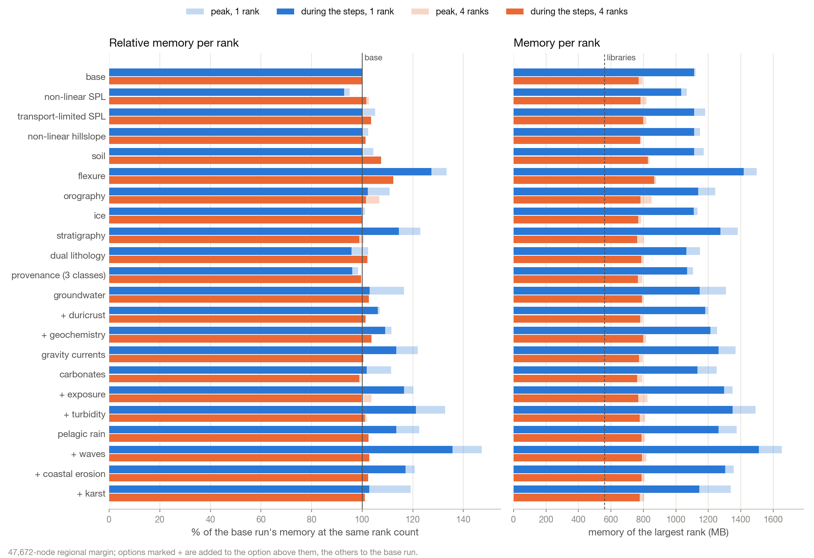

.. _option_cost:

==========================================
Cost of the options: time and memory
==========================================

Every process you switch on makes a step longer and holds more memory. This
page gives rough numbers to plan a run: start from a basic model, add the
processes you need, and add up their costs. They are measured, not
modelled, on one regional margin; read them as orders of magnitude.

.. contents:: On this page
   :local:
   :depth: 1

How it was measured
-------------------

- **Mesh**: the 200 x 100 km margin of the goSPL-examples
  ``mixed_carbonate_clastic`` example, 47,672 nodes (~700 m cells), with
  highlands, two large rivers, a shelf and a slope.
- **Base run**: linear stream power law with deposition (``spl: K, d``),
  linear hillslope and marine diffusion, marine deposition, a sea-level
  curve and a rainfall map, multiple flow directions; no stratigraphy. The
  solvers are the defaults (:ref:`solvers`).
- **Each option** is added alone to the base run, or to the option it needs
  (marked + in the charts), with the input blocks of the examples.
- **Time**: 10 steps of 5 kyr; the time of a step is the median over the
  steps after the first (the first sets up the solvers). The *added time* is
  how much the parts of the step the option acts in grow (the phases of the
  ``--summary`` record: its own, ``flexure``, ``groundwater``,
  ``carbonate``, ..., and the ones it makes heavier, the sediment routing
  ``sed`` and the marine step ``sea``), against the run it is added to.
- **Memory**: each rank's resident memory sampled during the run: the median
  during the steps and the peak, for the largest rank.
- **Machine**: Apple M4 Max laptop, macOS, goSPL 2026.7.14 with the gravity
  currents, carbonates and karst, PETSc 3.21; one and four MPI ranks.

Repeated runs of the base agree to about 3 % in time. The script is
``scripts/option_cost.py`` (:ref:`cost_measure`); the raw numbers are in
``docs/user_guide/scaling/``.

Time per step
-------------

.. figure:: ../_static/cost/option_time.png
   :width: 100%
   :align: center
   :alt: Time per step of each option, relative to the base run and in seconds.

   Left: the step of each option in % of the base step at the same rank count
   (tint: the whole step; solid: the time the option adds). Right: the time
   per step in seconds. The base step takes 1.67 s on one rank and 0.53 s on
   four.

.. include:: scaling/option_cost_table.rst

**How to read it.** The *added time* is the cost of the process itself: it
adds up. The whole step also contains how the option changes the landscape
the other processes work on, which can make a run cheaper (orographic rain
and the non-linear stream power law send less sediment to the sea on this
margin, so the marine step does less work) or dearer; that part depends on
your model.

- **What multiplies the routed columns** costs most: every lithology and
  every provenance class is routed through the cascades and spread by the
  marine diffusion with the bulk sediment. Dual lithology adds one column,
  the pelagic rain one (``carb_mud``), the carbonates three (``carb_sand``,
  ``carb_mud``, ``reef``), provenance one per class.
- **Processes with implicit solves of their own**: the soil, the groundwater
  head and its geochemistry, the transport-limited stream power law.
- **Cheap**: flexure (the operator is factorised once), ice, the
  stratigraphy itself, the carbonate factories, waves, coastal erosion and
  karst.

**With the mesh size.** On the same margin re-meshed from 12,000 to 757,000
nodes (four ranks), the base step grows about linearly with the number of
nodes (0.11 to 7.8 s). The relative cost of most options stays within
±10 % of the table: dual lithology +3 to +13 %, gravity currents +15 to +33 %,
the geochemistry +37 to +55 %, flexure about 0 %. Provenance (+22 to +54 %)
and the carbonates (+51 to +86 %) grow slowly with the size, and the soil
grows the most (+11 % at 12,000 nodes, +79 % at 757,000): its non-linear
solve needs more iterations on fine meshes.

Memory
------

   Left: memory per rank of each option in % of the base run's at the same
   rank count. Right: memory of the largest rank in MB (solid: median during
   the steps; tint: peak). The dashed line marks the ~560 MB of libraries
   every rank holds.

Each rank first holds about **560 MB** of libraries (PETSc, MPI, NumPy,
SciPy, VTK), whatever the mesh. The base model then needs a few kB per node
of the rank (the mesh, the flow and diffusion matrices and their solvers):
about 200 MB per rank here at four ranks, 550 MB on one rank.

On four ranks every option stays within +12 % of the base (flexure is the
largest: its factorised operator is kept for the whole run). On one rank
waves (+36 %, one transport solve per wave direction), flexure (+27 %) and
the turbidity and geochemistry solves (+10 to +20 %) stand out. Differences
below about 15 % on one rank are within the scatter of the measurement
(macOS reclaims freed memory lazily): stratigraphy alone reads +15 % and dual
lithology, which includes it, -4 %.

The cost that these 10-step runs do not show is the **stratigraphy**, which
allocates every layer of the run at the start:

.. list-table::
   :header-rows: 1
   :widths: 50 50

   * - Stratigraphy
     - bytes per node and per layer
   * - layers (thickness, elevation, porosity, erodibility)
     - 32
   * - dual lithology (mud pile and its porosity)
     - +16
   * - each further lithology (carbonates: three)
     - +16 each
   * - provenance tracers
     - +8 per class (+1 class with carbonates or pelagic rain)
   * - duricrust record, crust type, crust source (groundwater)
     - +8 each

The number of layers is the run length over the ``strat`` interval. A
1-million-node model with 100 layers, dual lithology and carbonates holds
1e6 x 100 x (48 + 48) B = 9.6 GB of stratigraphy, shared among the ranks:
as much as the rest of the model. With many layers, choose ``strat`` for the
resolution you need in the record, not the time step.

Building up a run
-----------------

Rough times relative to the base step (four ranks, from the table):

- erosion, hillslope and marine deposition: **1x**
- + stratigraphy and dual lithology: **~1.1x**
- + provenance (3 classes): **~1.45x**
- + carbonates, waves, coastal erosion and karst (on dual): **~1.9x**
- + groundwater, duricrust and geochemistry: **+0.5x**
- + soil: **+0.2x** (more on fine meshes)

Memory: ~560 MB per rank, plus a few kB per node of the rank, plus the
stratigraphy (per node and per layer, above).

.. _cost_measure:

Measuring it on your mesh
-------------------------

The numbers depend on the mesh, the resolution, the rank count and the
landscape. ``scripts/option_cost.py`` measures them for your own input:

.. code:: bash

    python scripts/option_cost.py my_input.yml -n 4 --steps 10 --workdir cost_np4
    python scripts/option_cost.py my_input.yml -n 1 --steps 10 --workdir cost_np1
    python scripts/option_cost.py --report cost_np4            # the table
    python scripts/option_cost.py --plot cost_np1 cost_np4 --out time.png
    python scripts/option_cost.py --plot-memory cost_np1 cost_np4 --lib-mb 560 --out memory.png

It keeps the core blocks of your input (domain, time, spl, diffusion, sea,
climate), runs the base and each option for ``--steps`` steps with
``mpirun -n``, and records the median step time, the option's added time and
the memory per rank; ``--only`` runs a subset (``--only flexure,gw_geochem``),
and the ``VARIANTS`` list in the script holds the option blocks.
``scripts/option_scaling.py`` repeats it on re-meshed copies of a flat
domain at several spacings and rank counts. For the memory by stage of the
set-up and the step, use ``scripts/mem_profile.py``; for the time by
sub-stage, ``scripts/stage_profile.py``.

To refresh this page (when a process is added or its cost changes), rerun the
script on the ``mixed_carbonate_clastic`` margin at one and four ranks, then
write the table with ``python scripts/option_cost.py --table cost_np1 cost_np4
--out docs/user_guide/scaling/option_cost_table.rst`` and the two charts as
above.
