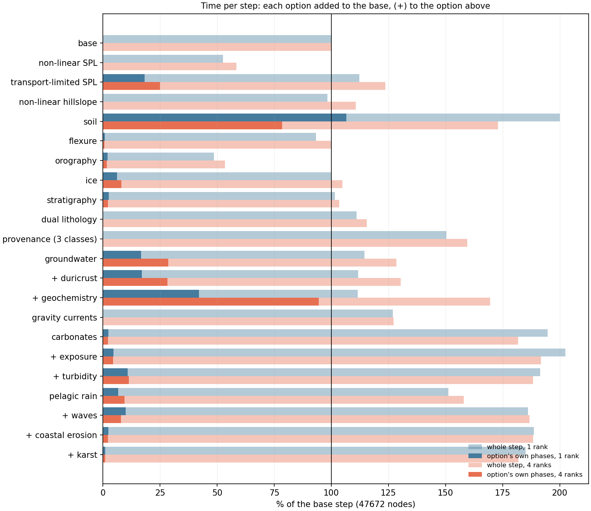
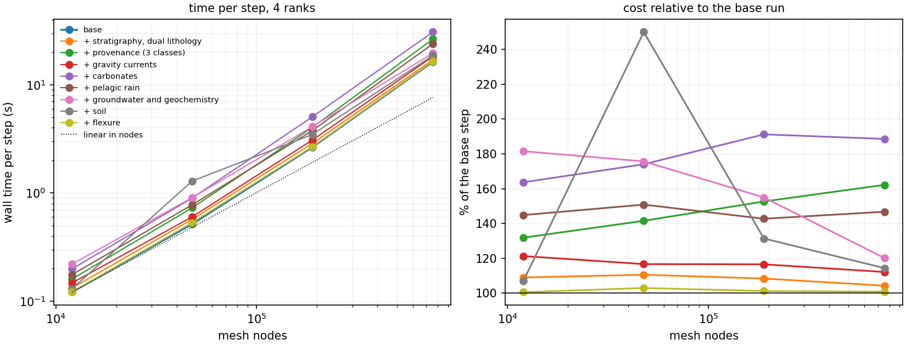
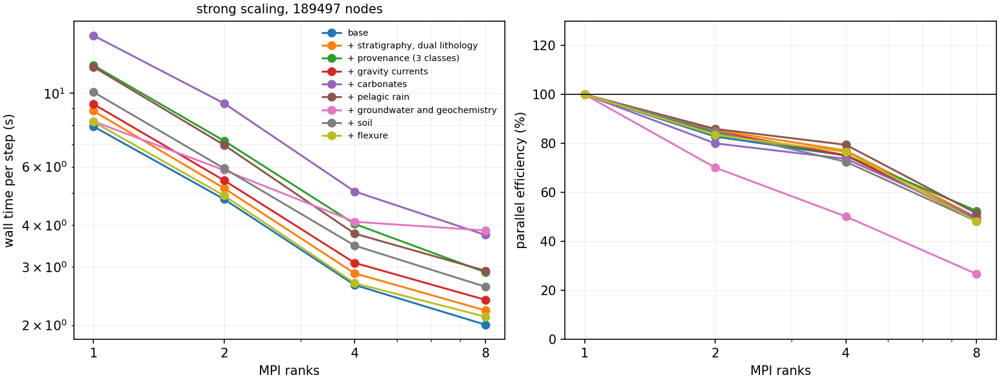
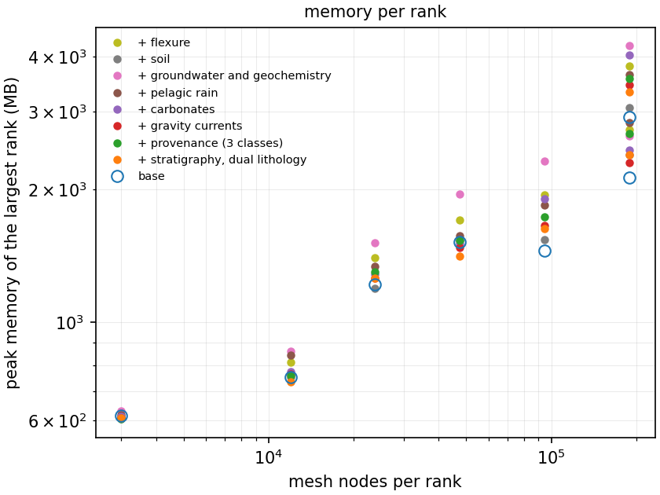

.. _option_cost:

==========================================
Cost of the options: time and memory
==========================================

Every process you switch on makes a step longer and holds more memory. This
page gives rough numbers to plan a run: start from a basic model, add the
processes you need, and add up their costs. They are measured, not
modelled, on one regional margin at several resolutions; read them as orders
of magnitude.

.. contents:: On this page
   :local:
   :depth: 1

How it was measured
-------------------

- **Mesh**: the 200 x 100 km margin of the goSPL-examples
  ``mixed_carbonate_clastic`` example (highlands, two large rivers, a shelf
  and a slope): its 47,672-node mesh (~700 m cells) for the table, and the
  same margin re-meshed at 1400, 700, 350 and 175 m (12,000 to 757,000
  nodes; elevation and rain interpolated, so the finer meshes add no
  topographic detail) for the scaling.
- **Base run**: linear stream power law with deposition (``spl: K, d``),
  linear hillslope and marine diffusion, marine deposition, a sea-level
  curve and a rainfall map, multiple flow directions; no stratigraphy.
- **Each option** is added alone to the base, or to the option it needs (the
  *added to* column), with the input blocks of the examples.
- **10 steps** of 5 kyr (6 for the scaling); the time of a step is the median
  over the steps after the first (the first sets up the solvers; the median
  keeps one slow step from dominating). The *own phases* column is the time
  spent in the option's own part of the step (the phases of the
  ``--summary`` record: ``groundwater``, ``carbonate``, ...).
- **Machine**: Apple M4 Max laptop (12 performance and 4 efficiency cores),
  macOS, goSPL 2026.7.14 with the gravity currents, carbonates and karst,
  PETSc 3.21.

Repeated runs of the base agree to about 3 %. The scripts are
``scripts/option_cost.py`` and ``scripts/option_scaling.py``
(:ref:`cost_measure`); the raw numbers are in ``docs/user_guide/scaling/``
(``option_cost_np1.json``, ``option_cost_np4.json``,
``option_scaling.json``).

Time per step
-------------

   Time per step of each option, in % of the base step (47,672 nodes), on one
   and four ranks: light bars the whole step, dark bars the option's own
   phases. Options marked + are added to the option above them.

Values in % of the base step; *own phases* on four ranks.

.. include:: scaling/option_cost_table.rst

**How to read it.** The *own phases* column is the cost of the process
itself: it adds up. The whole-step columns also contain how the option
changes the landscape the other processes work on, which can make a run
cheaper (orographic rain and the non-linear SPL lower the marine work on
this margin) or dearer; that part depends on your model.

- **What multiplies the routed columns** costs most: every lithology and
  every provenance class is routed through the cascades and spread by the
  marine diffusion with the bulk sediment. Dual lithology adds one column,
  the pelagic rain one (``carb_mud``), the carbonates three (``carb_sand``,
  ``carb_mud``, ``reef``), provenance one per class: 10 to 25 % of the step
  each.
- **Processes with implicit solves of their own**: the soil (SNES and TS,
  +75 to +95 %), the groundwater head (AMG, +15 to +30 %), its geochemistry
  (one direct factorisation per species).
- **Cheap**: flexure (the operator is factorised once), ice, the
  stratigraphy itself, gravity currents, the carbonate factories, waves,
  coastal erosion and karst (a few per cent to ~15 % each).

**Set-up time** (building the model) was about a second for every option
on the 47k mesh; on large meshes it is dominated by the mesh distribution
(:ref:`hpc_scaling`).

How the costs scale
-------------------

   Left: time per step against the mesh size on four ranks (the dotted line
   is linear in the number of nodes). Right: each configuration relative to
   the base run at the same size.

- **The time per step grows a little faster than the number of nodes**: as
  :math:`N^{1.18}` for the base from 12,000 to 757,000 nodes (0.12 s to 16 s
  per step on four ranks). The implicit solves need more iterations as the
  mesh is refined.
- **The relative cost of the options is about the same at every size**,
  so the table above can be used for larger meshes. On the largest mesh:
  flexure and dual lithology +1 to +4 %, gravity currents +12 %, the soil
  +14 %, the groundwater with its geochemistry +20 %, the pelagic rain +47 %,
  provenance +62 %, the carbonates +88 %. The provenance and the carbonates
  (more routed columns) grow slowly with the size; the geochemistry (direct
  solves) and the soil become relatively cheaper. The soil varies a lot
  between sizes: its adaptive solvers take more or fewer sub-steps with the
  landscape.

   Strong scaling on 189,497 nodes: time per step (left) and parallel
   efficiency (right) from one to eight ranks.

- **On one machine, the step time drops by 4 from one to eight ranks** (50 %
  efficiency) for every option, **except the geochemistry** (27 % at eight
  ranks): its direct factorisations scale less well than the iterative
  solves. Give a groundwater geochemistry run more nodes per rank.
- On this laptop 16 ranks were slower than 8 (the four efficiency cores hold
  the others back at every collective): use the performance cores only. The
  scaling on clusters, up to hundreds of ranks, is on the
  :ref:`HPC scaling page <hpc_scaling>`.

Memory
------

   Peak memory of the largest rank against the nodes it holds (all sizes and
   rank counts).

Each rank first holds about **560 MB** of libraries (PETSc, MPI, NumPy,
SciPy, VTK), whatever the mesh. The base model then needs about **11 kB per
node** of the rank at its peak (the mesh, the flow and diffusion matrices,
their solvers and the transient work of the marine step): 2.5 to 2.9 GB per
rank for 189,000 nodes per rank. On the largest mesh the options add, per
rank, up to +15 % (dual lithology), +35 % (carbonates: their lithology
columns) and +57 % (the geochemistry: its factorisations). On small meshes
the differences are within the scatter of the peaks, which are set by
transient solver work that depends on the landscape.

The one exception that grows with the length of the run is the
**stratigraphy**, which allocates every layer at the start:

.. list-table::
   :header-rows: 1
   :widths: 50 50

   * - Stratigraphy
     - bytes per node and per layer
   * - layers (thickness, elevation, porosity, erodibility)
     - 32
   * - dual lithology (mud pile and its porosity)
     - +16
   * - each further lithology (carbonates: three)
     - +16 each
   * - provenance tracers
     - +8 per class (+1 class with carbonates or pelagic rain)
   * - duricrust record, crust type, crust source (groundwater)
     - +8 each

The number of layers is the run length over the ``strat`` interval. A
1-million-node model with 100 layers, dual lithology and carbonates holds
1e6 x 100 x (48 + 48) B = 9.6 GB of stratigraphy, shared among the ranks:
as much as the rest of the model. With many layers, choose ``strat`` for the
resolution you need in the record, not the time step.

Building up a run
-----------------

Rough times relative to the base step (four ranks, from the table):

- erosion, hillslope and marine deposition: **1x**
- + stratigraphy and dual lithology: **~1.15x**
- + provenance (3 classes): **~1.6x**
- + carbonates, waves, coastal erosion and karst (on dual): **~1.9x**
- + groundwater, duricrust and geochemistry: **+0.7x**
- + soil: **+0.7x**

A run with everything on is then about three times the base step. Memory:
~560 MB per rank, plus ~11 kB per node of the rank, plus up to a half more
with the carbonates and the geochemistry, plus the stratigraphy (per node and
per layer, above).

.. _cost_measure:

Measuring it on your mesh
-------------------------

The numbers depend on the mesh, the resolution, the rank count and the
landscape. Two scripts measure them for your own input:

.. code:: bash

    # each option against the base, at one rank count
    python scripts/option_cost.py my_input.yml -n 4 --steps 10 \
        --workdir cost_np4
    python scripts/option_cost.py --report cost_np4          # the table
    python scripts/option_cost.py --plot cost_np1 cost_np4 --out time.png

    # the same at several mesh spacings and rank counts (flat meshes)
    python scripts/option_scaling.py my_input.yml --workdir scaling \
        --spacings 1400,700,350,175 --ranks 4 \
        --strong-spacing 350 --strong-ranks 1,2,4,8
    python scripts/option_scaling.py --plot scaling --out scaling

``option_cost.py`` keeps the core blocks of your input (domain, time, spl,
diffusion, sea, climate), runs the base and each option for ``--steps``
steps with ``mpirun -n``, and prints the median step time, the option's own
phases and the peak memory per rank, relative to the base; ``--only`` runs a
subset (``--only flexure,gw_geochem``), and the ``VARIANTS`` list in the
script holds the option blocks. ``option_scaling.py`` re-meshes a flat
domain at each spacing and runs ``option_cost.py`` for each mesh and rank
count. For the memory by stage of the set-up and the step, use
``scripts/mem_profile.py``; for the time by sub-stage,
``scripts/stage_profile.py``.

To refresh this page (when a process is added or its cost changes), rerun
both scripts on the ``mixed_carbonate_clastic`` margin and write the table
with ``python scripts/option_cost.py --table cost_np1 cost_np4 --out
docs/user_guide/scaling/option_cost_table.rst``.
